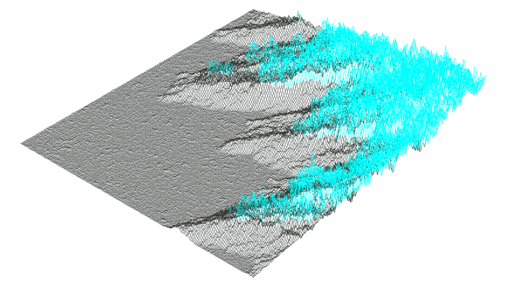
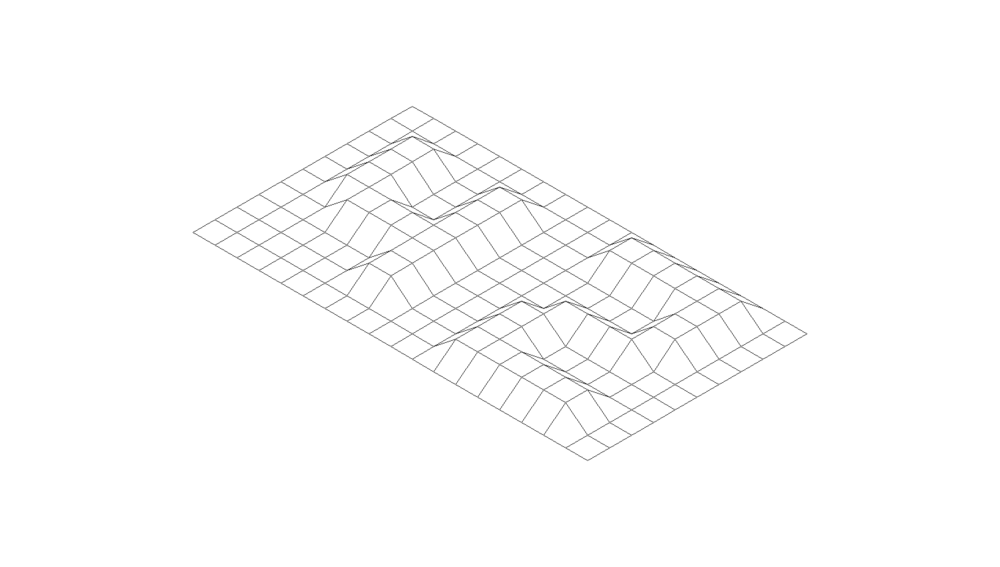

# FdF

> A **3D wireframe renderer** written in C: it reads a height map and draws it as an isometric wire mesh with the [MLX42](https://github.com/codam-coding-college/MLX42) graphics library.


[](https://github.com/codam-coding-college/MLX42)




## About

FdF ("*fil de fer*", French for *wireframe*) turns a grid of numbers into a 3D landscape.
Every number in a `.fdf` file is a point's height; the program connects neighbouring points
with lines and projects the result isometrically onto the screen. Everything between
reading the file and lighting up a pixel is done by hand: parsing, projection, scaling,
centring and line drawing.

## Features

- **Map parser** built on my own `libft` / `get_next_line`: checks that every row has the same width and reads optional per-point colours
- **Isometric projection** (30°) of every point, with the height pulled up along the screen's Y axis
- **Auto-fit**: the grid spacing is chosen from the map size so small and large maps both fit the window, then the model is centred
- **Bresenham's line algorithm** implemented from scratch, integer-only, for every edge of the mesh
- **Colours per vertex** taken straight from the map (`z,0xCOLOR`)
- **Panning** with the keyboard, and a clean exit with all memory freed (leak-free)

## Map format

A map is a grid of integers separated by spaces. Each value is the height (`z`) of that point;
a colour can be attached as `z,0xCOLOR` (an MLX42 RGBA value).

```
0  0  0  0  0
0 10 10 10  0
0 10 20,0xFF0000FF 10  0
0 10 10 10  0
0  0  0  0  0
```

The [`test_maps/`](test_maps) folder has more than twenty maps to try, from a simple `42` to fractals and terrain.



## Build & run

Requires `cc`, `make`, `cmake` and GLFW (`libglfw3-dev` on Debian/Ubuntu, `brew install glfw` on macOS).
The Makefile detects Linux or macOS and links the right libraries; MLX42 is built automatically.

```bash
make
./fdf test_maps/42.fdf
```

## Controls

| Key | Action |
|---|---|
| `W` `A` `S` `D` | Move the model up / left / down / right |
| `Esc` or close the window | Quit |

## Project layout

| File | Role |
|---|---|
| `utils.c`, `read_map.c`, `processing_input.c` | Measure the map, parse heights and colours |
| `projection.c` | Isometric projection |
| `map_positioning.c` | Shift and centre the model in the window |
| `algorithm.c`, `draw.c` | Bresenham line drawing and the mesh render loop |
| `hooks.c`, `move_pic.c` | Keyboard input and panning |
| `memory_utils.c`, `free_mem.c` | Allocation and cleanup |

---

<sub>Part of the <a href="https://www.codam.nl/">Codam</a> (42 network) curriculum.</sub>
